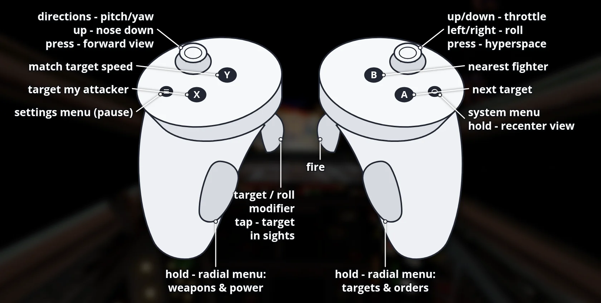

# OpenXvT VR for Meta Quest

**Download, install guide, controls and pictures: [portroyale.online/openxvt.html](https://portroyale.online/openxvt.html)**

Standalone Meta Quest 3 port of OpenXvT (Star Wars: X-Wing vs. TIE Fighter
and Balance of Power) with OpenXR: menus on a virtual screen,
head-tracked stereo 3D space in flight, 3D cockpits from
X-Wing Revival (included) and Touch controller support. The same APK is
meant for PICO headsets too (untested).

You need your own copy of X-Wing vs. TIE Fighter (Steam "STAR WARS X-Wing
vs TIE Fighter - Balance of Power Campaigns"). The APK contains no game
data.

## Install

1. Install the APK with SideQuest or `adb install OpenXvT-VR-*.apk`.
2. Copy the whole game folder from Steam (`STAR WARS X-Wing vs TIE
   Fighter`, about 400 MB) to the Quest's internal storage as `OpenXvT`,
   for example:

       adb push ".../steamapps/common/STAR WARS X-Wing vs TIE Fighter/." /sdcard/OpenXvT/

3. Start "OpenXvT VR" from Unknown Sources. On first start, allow
   "access to all files" when Android asks (or run
   `adb shell appops set --uid com.bilko.openxvtvr MANAGE_EXTERNAL_STORAGE allow`).

## Controls

Recenter: hold the Meta button on the right controller.

Menus (left controller; in the main menus the right controller also works
as the mouse, in a mission it does nothing in menus):

| Input | Game menus | OpenXvT settings (Menu in flight) |
|---|---|---|
| Laser | Left controller (main menus: either) | - |
| Trigger | Click (laser hand) | Left: previous page |
| Grip | Right-click (laser hand) | Left: next page |
| Left stick | Arrow keys | Move the selection |
| X | Enter | Select |
| Y | Space | Back |
| Left Menu | Escape | Close |

When the game asks for text (pilot name), a virtual keyboard appears below
the screen; point at a key and pull the trigger.

Flight (the Touch controllers act as one gamepad; every button can be
remapped in Settings > Controller):

| Input | Action |
|---|---|
| Left stick | Pitch and yaw (up = nose down, like a flight stick) |
| Right stick left/right | Roll |
| Right stick up/down | Throttle lever (stays where you leave it) |
| Right trigger | Fire |
| Left trigger | Target / roll modifier (tap: target the craft in your sights) |
| A / B | Next target / nearest fighter |
| X / Y | Target my attacker / match target speed |
| Left stick click | Forward view |
| Right stick click | Hyperspace |
| Left Menu | OpenXvT menu (pauses the game) |
| Left grip (hold) | Radial menu: weapons and power |
| Right grip (hold) | Radial menu: targets and orders |

Radial menus: hold a grip and a star of eight commands appears above that
controller. Tilt the same hand's stick towards a command and release the
grip to run it; release with the stick centred to cancel. The stick doesn't
fly while it is choosing; everything else keeps working.

| Direction | Left (weapons and power) | Right (targets and orders) |
|---|---|---|
| Up | Laser recharge rate | Clear target |
| Up-right | Shield recharge rate | Next target component |
| Right | Cycle weapon (lasers / warheads) | Map |
| Down-right | Full throttle | Wingmen: attack my target |
| Down | Throttle down | Wingmen: cover me |
| Down-left | Beam weapon on/off | Mission goals |
| Left | Cycle firing mode | OpenXvT menu (pauses) |
| Up-left | Cycle shield direction | Target's attacker |

## 3D cockpits

The X-wing, Y-wing, A-wing, B-wing, TIE Fighter, TIE Interceptor, TIE
Bomber and Assault Gunboat use their X-Wing Revival cockpits. Craft
without one borrow the closest model: Z-95 and T-wing use the X-wing
cockpit, R-41 the A-wing, TIE Advanced the TIE Fighter, TIE Defender the
TIE Interceptor and the Missile Boat the Gunboat. The original
instruments float in front of you; the small built-in screens of the
Revival models are dark. All other craft keep the original 2D cockpit.

## Known limitations (beta)

- Quest 3 tested only; PICO and multiplayer are untested.
- Motion blur, temporal upscaling and ambient occlusion are off in stereo.
- The galaxy map and the hyperspace jump are shown flat.
- Signed with a debug key.

## Build (Linux host)

Requirements: Android SDK + NDK 27.2.12479018, JDK 17, SDL_shadercross
(see `packaging/linux/Dockerfile`), CMake, Ninja, Python 3.

    git submodule update --init --recursive
    tools/quest/build-deps.sh      # SDL3, zstd, FFmpeg, mbedTLS, curl
    tools/quest/build-native.sh    # libmain.so + runtime resources + cockpits
    (cd android && ./gradlew assembleRelease)
    tools/quest/deploy.sh          # install, copy game data once, launch

`build-native.sh` bundles the cockpits from an unpacked X-Wing Revival
download (set `REVIVAL_DIR` to the folder containing `Models/` and
`Textures/`).

VR code: `src/xvt_vr/` (OpenXR session, input, layers; `xvt_vr.c` is
generated from OpenXWA-VR's `xwa_vr.c` by `tools/quest/gen_xvt_vr.py`,
radial menus in `vr_radial_menu.c` from OpenTIE-VR),
`src/xvt_remaster/vr_stereo.*`, `flight_scene.c` and `flight_pipeline.c`
(per-eye rendering), `src/xvt_remaster/vr_cockpit.*` (3D cockpits) and the
Quest VR engine changes in the `aeron` submodule
([Aeron commit 65b3e7c](https://github.com/elyosh/Aeron/tree/65b3e7cfc5e7e8ffcc41362e478002af5504f051):
external present path, OBJ model loader).

## Credits

OpenXvT by [elyosh](https://github.com/elyosh/OpenXvT). 3D cockpit models
from [X-Wing Revival](https://www.raptor007.com/xwing/) by Raptor007 and
its contributors (originally from the X-Wing Alliance Upgrade project).
